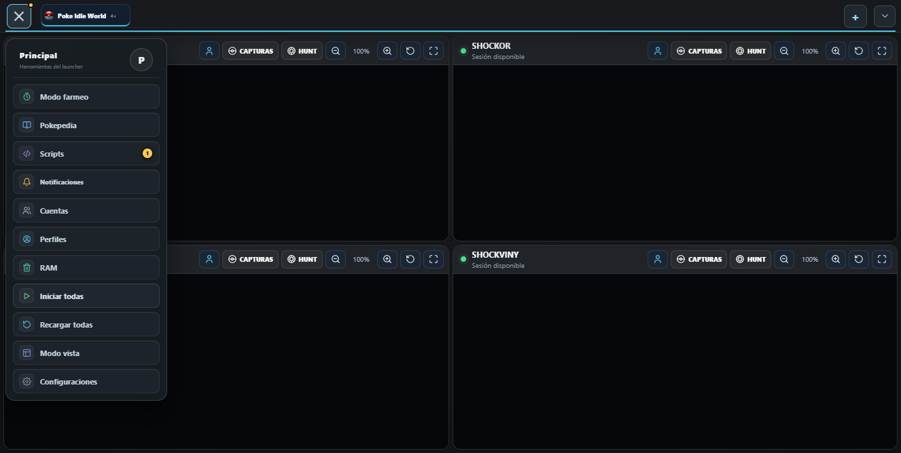
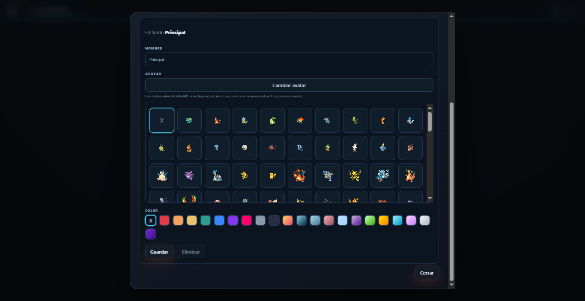
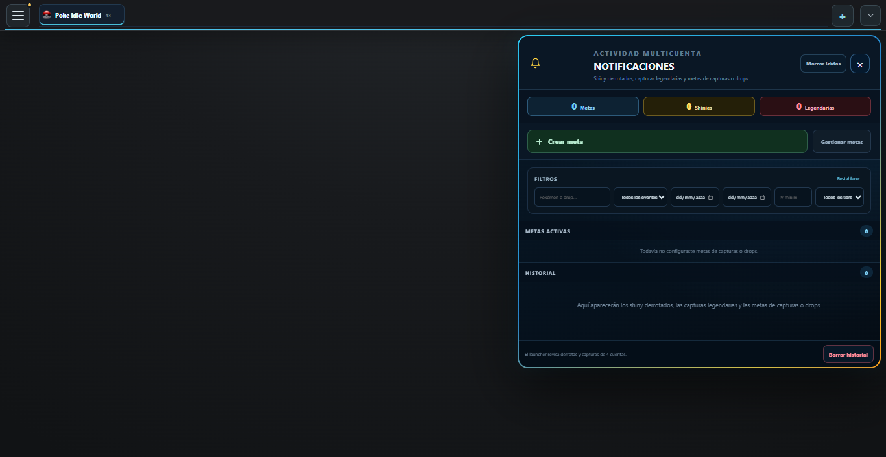
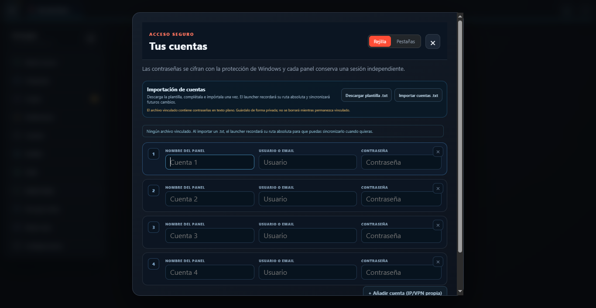
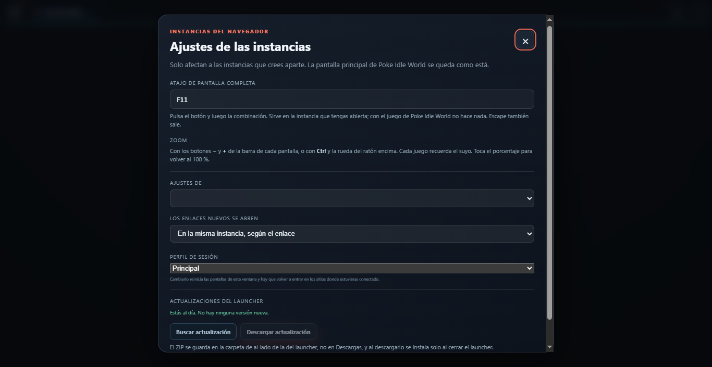
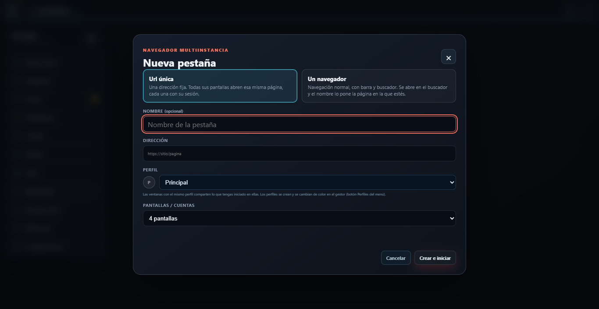
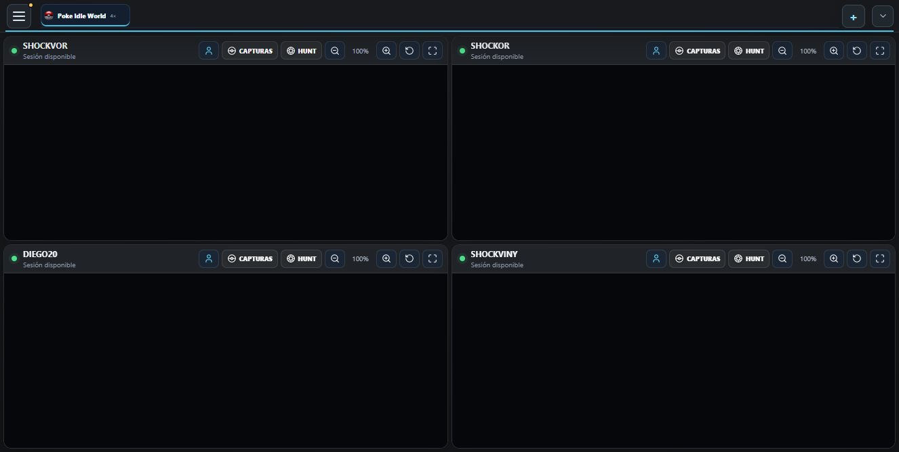
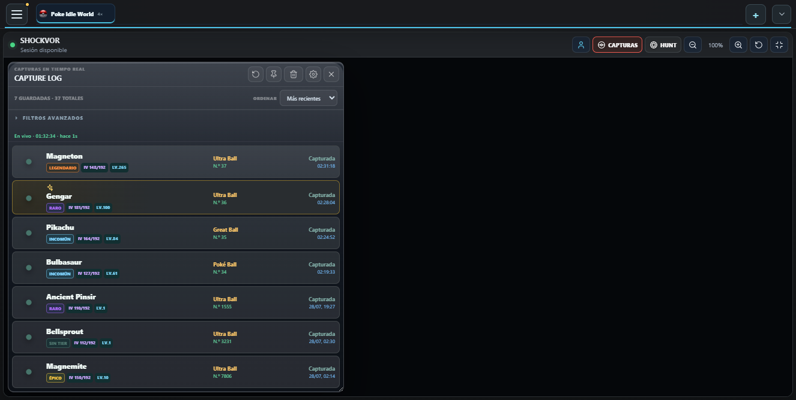
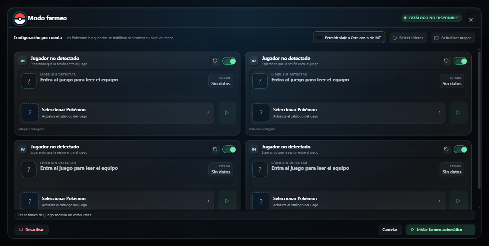

# IDLE POKE LAUNCHER

Launcher portátil para Windows para administrar **Poke Idle World y otros juegos de navegador** con
sesiones independientes por perfil, herramientas de seguimiento en tiempo real, userscripts
multijuego y actualización automática.

[](https://github.com/DiegoT34/PokeGrid-Launcher/releases/latest)
[](https://github.com/DiegoT34/PokeGrid-Launcher/releases)
[](https://github.com/DiegoT34/PokeGrid-Launcher/releases/latest)
[](LICENSE)

> Proyecto independiente. PokeGrid Launcher no está afiliado con Pokémon, Nintendo, Game Freak ni
> Poke Idle World.



## Qué es, en una frase

Un programa que abre **el mismo juego varias veces a la vez**, cada copia con su propia sesión de
navegador, y te enseña en una sola pantalla lo que está pasando en todas: capturas, shinies,
legendarios, hunts, Drops y errores de conexión.

## Descargar

1. Abre la [última versión publicada](https://github.com/DiegoT34/PokeGrid-Launcher/releases/latest).
2. Descarga `IDLE-POKE-LAUNCHER-x.y.z-portatil.zip`.
3. Descomprime el ZIP en una carpeta con permisos de escritura.
4. Ejecuta `IDLE POKE LAUNCHER.exe`.

No necesita instalador. Las cuentas, sesiones, perfiles y preferencias se guardan en el perfil de
usuario de Windows, **fuera** de la carpeta del programa: puedes mover o borrar la carpeta del
launcher sin perder nada.

> Se conservan las últimas cinco releases. Las anteriores se retiraron para no ocupar espacio; el
> código de cada versión sigue en el historial de Git, con su etiqueta.

---

## Las tres cosas que lo distinguen

### 1. Perfiles de sesión, como los de un navegador

Hasta la 0.36.0 todas las ventanas compartían una sola sesión: si entrabas en Google en una, ya lo
tenías en todas, y no había forma de tener dos cuentas del mismo sitio a la vez. Desde la 0.37.0 cada
ventana trabaja en un **perfil**.

Un perfil es una sesión con nombre. Las ventanas del mismo perfil comparten lo que tengas iniciado
dentro; las de perfiles distintos **no se ven entre sí**, ni por cookies ni por almacenamiento.



- Se crean y se borran desde el botón **Perfiles** del menú.
- Cada perfil tiene nombre, **avatar** (132 Pokémon de PokéAPI) y **color** —plano o degradado—.
- El color vive **en el perfil**, no en la barra de pestañas: en la barra manda el nombre, y ahí solo
  caben las palabras.
- Cambiar el perfil de una ventana **avisa antes**: reinicia sus pantallas y te deja sin sesión en los
  sitios donde estuvieras conectado, así que pregunta y lo deja claro.
- El perfil activo se ve **en la cabecera del menú**, junto a su círculo. Con varias ventanas de
  perfiles distintos abiertos, es la única forma de saber en cuál de ellas estás.
- Las **cuentas del juego no se tocan**: usan su propia sesión siempre, como antes.

El avatar se baja **solo al abrir el selector**, nunca al arrancar el launcher. La rejilla se llena
sola, en tandas, mientras puedes seguir usando el gestor.

### 2. Todo lo de cada cuenta, en un sitio



Un solo panel recoge la actividad de **todas** las cuentas: capturas, shinies, legendarios, Drops y
las metas que tú definas (por Pokémon, IV, tier y cantidad). Filtra por cuenta, fecha, tipo y rareza.
Puedes poner metas como «este shiny, IV 180 o más» y el launcher te avisa cuando ocurra.

Los avisos no se apagan al mirarlos: se apagan cuando los instalas. Y el aviso de «hay versión
nueva» tampoco, porque es la única señal de que la tienes pendiente.

### 3. Userscripts y una Shop con verificación

Centro de scripts con editor, permisos visibles, instalación por URL, importación y arrastrar y
soltar. Cada script detecta solo en qué pantallas encaja por `@match`/`@include`, y se instala,
actualiza y recarga únicamente en las compatibles con su juego.

La **Shop** consulta un catálogo actualizado desde GitHub y verifica el **SHA-256** de cada descarga
antes de guardarla. Nada se instala sin comprobar.

---

## Funciones

**Multicuenta**
- De **1 a 32** cuentas de Poke Idle World simultáneas, con sesión, cookies y almacenamiento
  separados por cuenta.
- Añadir, eliminar y reordenar desde el modal **Cuentas**, conservando la sesión de cada una.
- **VPN o IP distinta por cuenta**: protocolo `http` o `socks5`, con host, puerto y credenciales
  opcionales. Solo afecta a esa cuenta.
- Importación por plantilla `.txt` de 1 a 32 secciones, con sincronización manual y sin perder
  sesiones al re-sincronizar.

**Instancias de otros juegos**
- El botón `+` de la barra de pestañas crea una instancia de navegador con nombre, enlace y de **1 a 6
  pantallas**, cada una con su almacenamiento.
- Hasta **12 instancias** adicionales guardadas, que reaparecen al abrir el launcher.
- Cada instancia elige su **perfil de sesión**, así que dos ventanas del mismo juego pueden llevar
  cuentas distintas.

**Interfaz**
- Menú lateral flotante que se superpone sin reducir ni desplazar las ventanas del juego, y barra
  superior ocultable. Los dos estados se conservan al reiniciar.



- Barra de pestañas con el nombre de cada ventana, con arrastre para reordenar y `Alt` + flechas para
  no depender del ratón.
- **Modo vista** para decidir qué paneles se ven.
- Zoom y expansión individual por pantalla.

**Seguimiento**
- **Hunt Analyzer** por cuenta: derrotados, XP, capturas, shinies, botín, suministros, balance,
  rendimiento por hora y drops.
- **Capture Log** por cuenta: historial de capturas con IV, Quality/Tier, nivel y Poké Ball, con
  filtros y detalle individual.
- **Estadísticas generales**: resumen por cuenta y comparación de hunts ordenada por rendimiento, con
  color propio para cada cuenta.
- **Modo farmeo**: analiza el Pokémon líder, nivel, tipos y mapas, y propone objetivos disponibles.
- **Pokédex** en ventana independiente.

**Conectividad y recursos**
- Inicio conjunto y **recarga escalonada** para evitar picos y desconexiones.
- Recuperación automática por pantalla: una cuenta caída no arrastra a las demás.
- Botón **RAM** que limpia solo cachés regenerables, sin cerrar sesiones ni tocar cookies.
- Trabajo en reposo: lo que no se está mirando deja de consumir CPU.

**Userscripts**
- Editor con validación de sintaxis antes de guardar, y permisos y dominios declarados a la vista.
- Instalación por URL, importación, exportación y arrastrar y soltar.
- **Pestaña Actualizaciones**: solo los scripts con versión más nueva que la instalada.

**Mantenimiento**
- **Actualizador integrado** con verificación SHA-256 y reversión automática si la versión nueva no
  arranca. Va en [Actualizaciones](#actualizaciones-del-launcher).
- Cerrar por el botón de la ventana deja el launcher limpio; nada se guarda en la carpeta del
  programa.

---

## Actualizaciones del launcher

Desde la **0.39.0** el botón de actualizar **ya no está en el menú**: está en **Configuraciones**,
con dos botones en lugar de uno.



- **Buscar actualización** — solo mira. No instala, no pregunta por instalar y no puede cerrar el
  launcher.
- **Descargar actualización** — sale apagado hasta que se ha confirmado que hay algo. Es la diferencia
  con el botón antiguo: con uno solo no había manera de saber si había actualización sin pulsarlo, y
  pulsar era descargar 60 MB.

El launcher **comprueba solo** al arrancar y cada seis horas, y avisa con una bolita verde en el
botón de Configuraciones. Ese aviso **no se apaga al mirarlo**: sigue ahí hasta que la actualización
se instala de verdad. Un arranque sin conexión tampoco lo apaga.

### Dónde se guarda

El ZIP **no va a la carpeta de Descargas**. Va a **la carpeta que contiene la del launcher**: si el
launcher está en `D:\Juegos\PokeGrid-Launcher\`, la actualización aparece en `D:\Juegos\`, al lado y
en el mismo disco.

Si esa carpeta no existe o no se puede escribir —o si estás en una copia de desarrollo, donde el
ejecutable vive dentro de `node_modules`— se usa Descargas, que es lo de siempre. Un fallo al elegir
carpeta acaba **descargando**, no rompiendo el launcher.

### Qué pasa al aceptar

1. Consulta la Release estable más reciente de este repositorio.
2. Compara la versión instalada.
3. **Pregunta antes de descargar nada**, indicando la versión instalada y la disponible. Si cancelas,
   el aviso sigue pendiente.
4. Descarga el ZIP y lo conserva, con su `.sha256`, en la carpeta de al lado del launcher.
5. **Verifica el SHA-256** antes de descomprimirlo. Si no coincide, no descomprime nada.
6. Cierra el launcher y abre la nueva versión en una carpeta portátil independiente.
7. Espera a que la ventana nueva confirme que está preparada.
8. **Si el arranque no se confirma, restaura la versión anterior** y vuelve a abrirla.

Detalle completo en [docs/ACTUALIZACIONES.md](docs/ACTUALIZACIONES.md).

---

## Instancias de otros juegos



El botón `+` de la barra de pestañas abre este modal: nombre, enlace HTTPS, de 1 a 6 pantallas, modo
de apertura de los enlaces nuevos y **perfil de sesión**.

El desplegable de perfil enseña el círculo del perfil elegido, el mismo que en el gestor. **Crear
perfiles no se hace desde aquí**: aquí se elige con qué perfil se abre una ventana, y crear un perfil
es decidir cómo se llama una sesión que tendrá las suyas. Eso es cosa del botón **Perfiles**.

---

## Los paneles, uno a uno

### Hunt Analyzer



Derrotados y por hora, duración y estado en vivo, XP total y por hora, capturas, shinies y
legendarios, botín, suministros, balance y drops de la sesión. Un panel flotante propio por cuenta.

### Capture Log



Historial de capturas por cuenta, con IV, Quality/Tier, nivel, Poké Ball y fecha, filtros y detalle
individual de cada una.

### Modo farmeo



Analiza el Pokémon líder detectado, su nivel, tipos, mapas y compatibilidad para organizar objetivos
disponibles por cuenta. Filtra por nombre, región, tipo, nivel, combate y variante shiny. No inicia
viajes sin que lo pidas.

---

## Desarrollo

Requiere **Windows**, **Node.js 22 o superior** y **pnpm**.

```powershell
pnpm install
pnpm check      # sintaxis de todos los ficheros de src
pnpm start      # abre el launcher en desarrollo
```

### La puerta del área

**Las pruebas, o no se compila.** Antes de compilar una entrega se ejecuta el área entera en orden:

```powershell
powershell -NoProfile -ExecutionPolicy Bypass -File herramientas\area-entera.ps1
```

Son 26 pruebas —sintaxis, invariantes de código, la barra de pestañas, las instancias, el descanso de
CPU, las cuentas, los perfiles, los iconos, el actualizador y las notificaciones— y el guion **no
sigue si alguna falla**. Además, `verificar-paquete` y `comprobar-entrega` se ejecutan **después** de
compilar, cuando ya miran el artefacto de verdad:

```powershell
pnpm dist
node herramientas\verificar-paquete.cjs
node herramientas\comprobar-entrega.cjs
```

### Pruebas sueltas

```powershell
pnpm test      # suites de Node, rápido
pnpm test:e2e  # suites de Electron
pnpm test:all  # ambas
```

### Capturas del repositorio

Las imágenes de este README se generan, no se toman a mano. Para rehacerlas:

```powershell
node tests\lanzar.cjs herramientas\capturas-readme.cjs preview  # paneles y rejilla
node tests\lanzar.cjs herramientas\capturas-readme.cjs app      # menú, perfiles, ajustes
```

`preview` usa el preload de pruebas para inventar cuatro cuentas; `app` abre el launcher real, que es
lo único que sirve para los avatares, porque los sprites salen de PokéAPI de verdad.

---

## Seguridad y privacidad

- Las contraseñas **no se publican ni se incluyen** en los paquetes, y se cifran con la protección de
  Windows (`safeStorage`/DPAPI). Solo se escriben en la página oficial de acceso.
- Cada cuenta usa una partición persistente independiente.
- El actualizador solo acepta Releases de `DiegoT34/PokeGrid-Launcher` y **exige SHA-256**.
- Los enlaces externos se abren fuera de los paneles del juego.
- **No hay telemetría** propia del launcher.

Informa de problemas en [SECURITY.md](SECURITY.md).

### Aviso de Windows (SmartScreen)

El ejecutable no está firmado con un certificado comercial, así que SmartScreen puede mostrar «Windows
ha protegido tu PC» la primera vez en un equipo nuevo. Es lo normal en una aplicación portátil sin
firmar.

**Qué hacer:** pulsa **Más información** y luego **Ejecutar de todas formas**.

En las actualizaciones posteriores el aviso no aparece: el actualizador descarga el ZIP con la red de
Node y lo descomprime con PowerShell, sin la marca de descarga que el navegador añade a los archivos.
Depende de la configuración de cada equipo, así que si vuelve a salir, lo mismo.

**Verificar la integridad antes de ejecutar:** descarga también el
`IDLE-POKE-LAUNCHER-x.y.z-portatil.zip.sha256` de la misma Release y compara:

```powershell
Get-FileHash .\IDLE-POKE-LAUNCHER-x.y.z-portatil.zip -Algorithm SHA256
```

En la **primera descarga manual** esa comparación la tienes que hacer tú. La verificación automática
sí existe, pero solo dentro del actualizador.

Guía completa en [docs/RECOMENDACIONES-SMART-SCREEN.md](docs/RECOMENDACIONES-SMART-SCREEN.md).

---

## Documentación

| Documento | Qué hay en él |
|---|---|
| [docs/FUNCIONES.md](docs/FUNCIONES.md) | Guía completa de funciones, campo por campo. |
| [docs/ACTUALIZACIONES.md](docs/ACTUALIZACIONES.md) | Cómo se publica una versión y qué hace el actualizador. |
| [docs/SCRIPT_SHOP.md](docs/SCRIPT_SHOP.md) | Cómo publicar un script en la Shop. |
| [REGISTRO.md](REGISTRO.md) | Una entrada por versión, con lo que cambió y **por qué**. |
| [MAPA-DEL-PROYECTO.md](MAPA-DEL-PROYECTO.md) | Dónde está cada cosa. |

El [REGISTRO.md](REGISTRO.md) es el documento más útil del repositorio: no dice qué hace el código,
dice **qué se decidió y por qué**. Sin eso, dentro de seis meses el código explica *qué* hace pero
nadie recuerda *decide qué*.

## Licencia

MIT. Ver [LICENSE](LICENSE).

## Créditos

Creado y mantenido por **[DiegoT34](https://github.com/DiegoT34)**, autor y responsable principal de
PokeGrid Launcher.

Los sprites de los avatares de perfil y los datos de los Pokémon vienen de
[PokéAPI](https://pokeapi.co/). Los scripts de la Shop se publican en un repositorio aparte.